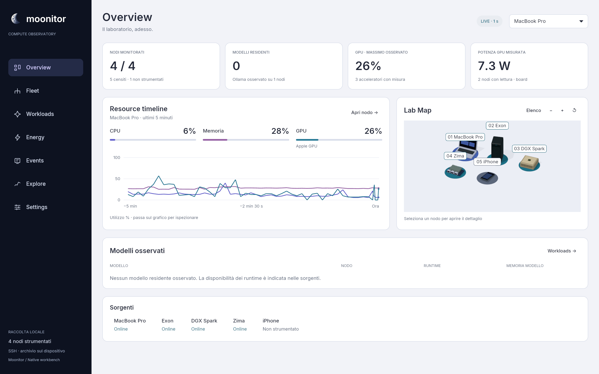
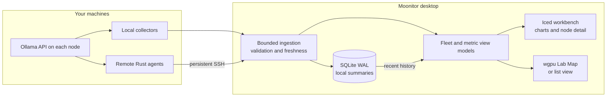

<h1 align="center">
  
  Moonitor
</h1>

<p align="center">
  <strong>Your compute lab, in focus.</strong><br />
  <sub>Native observability · Hardware · GPUs · Local AI · LAN &amp; VPN</sub>
</p>

<p align="center">
  <a href="https://github.com/mothx9/moonitor/actions/workflows/ci.yml"></a>
  <a href="rust-toolchain.toml"></a>
  <a href="#architecture"></a>
  <a href="Cargo.toml"></a>
  <a href="#roadmap"></a>
</p>

<p align="center">
  <sub>
    <a href="#the-workbench">Workbench</a> ·
    <a href="#quick-start">Quick start</a> ·
    <a href="#connect-your-fleet">Connect your fleet</a> ·
    <a href="#architecture">Architecture</a> ·
    <a href="#roadmap">Roadmap</a> ·
    <a href="#documentation">Docs</a>
  </sub>
</p>

<p align="center">
  <picture>
    <source media="(prefers-color-scheme: dark)" srcset="docs/assets/overview-dark.png" />
    <source media="(prefers-color-scheme: light)" srcset="docs/assets/overview-light.png" />
    
  </picture>
</p>

<p align="center">
  <sub>Actual native app · live telemetry · 23 October 2026 · <a href="docs/assets/overview-light.png">Light</a> / <a href="docs/assets/overview-dark.png">Dark</a></sub>
</p>

Moonitor brings local and remote machines into one desktop workbench. See which
nodes are reachable, inspect their resources, identify resident AI models and
check the provenance of available power readings. Collection stays on your
machines; history stays in a local SQLite database.

Built in **Rust**, with **Iced + wgpu** for the desktop. No browser shell, cloud
account or required monitoring server. This is an actively developed product;
the [roadmap](#roadmap) separates shipped foundations from planned capabilities.

## The workbench

| View | What you can inspect today |
| :--- | :--- |
| **Overview** | Monitored nodes, observed model residency, GPU activity, measured GPU board power and an inspectable resource timeline. |
| **Fleet** | Comparable node inventory, availability and a shared selection model. The Lab Map represents the configured fleet, from 0 to 32 nodes. |
| **Node detail** | CPU and memory, individual GPUs, sensors, bounded process lists, disk capacity, interface traffic, local AI and recent history. |
| **Workloads** | Ollama model residency, allocation, quantization and context where exposed by the runtime. |
| **Energy** | Available GPU board power readings, their scope and measurement coverage. |
| **Explore** | Five-minute CPU/RAM/GPU charts with time, scale, sample inspection and explicit gaps. |
| **Events & Settings** | Current source diagnostics, connection/configuration information and collection status. |

Light and dark themes share the same data model. The 3D Lab Map supports picking,
camera controls and an alternative list view; it renders on state changes and
interaction instead of running a decorative animation loop.

**Keyboard:** `Cmd/Ctrl + 1…7` changes section, `Alt + ←/→` changes node, and
`Tab` / `Shift + Tab` moves focus. Full assistive-technology support remains open.

### Measurements you can interpret

| Source | Available observations |
| :--- | :--- |
| **macOS / Linux** | CPU and per-core use, memory, swap, top processes, disk capacity and network-interface traffic. Linux PSI; supported temperature and battery sensors. |
| **NVIDIA · NVML** | Per-GPU utilization, memory, temperature, clocks, board power and throttle reasons, subject to device/driver support. |
| **Apple Silicon · IOKit** | GPU activity and shared-memory counters where exposed by the platform. Unified memory remains part of system RAM. |
| **Ollama · local API** | Loaded models and metadata returned by `/api/ps`. Loaded does not mean actively generating. |
| **Inventory only** | Devices without an agent remain visible as uninstrumented, without being counted as offline monitored nodes. |

Missing, unsupported, denied and stale readings are explicit states; **zero is a
valid measurement**. GPU board watts are not whole-device watts. Summary GPU
utilization is labeled as the observed maximum; individual accelerators remain
visible in node detail.

> **Current scope:** request-level token throughput, TTFT and queues are not yet
> instrumented. Events has no persisted timeline; Explore does not yet browse
> long-range history. Whole-device energy and integrated Wh are planned.
> Collection stops when the desktop closes.

## Quick start

### Build from source

Install Rust through `rustup` and your platform's native build tools: Xcode Command
Line Tools on macOS, or a C toolchain on Linux. A graphical desktop and a working
wgpu backend are required. Rust **1.96.0** is pinned in `rust-toolchain.toml`;
dependencies are pinned in `Cargo.lock`.

```sh
git clone git@github.com:mothx9/moonitor.git
cd moonitor
cargo run --release --locked -p moonitor-desktop
```

The repository is private; cloning requires access. Without an explicit or
previously installed `fleet.toml`, the app monitors the local computer only.

### macOS app bundle

```sh
scripts/run.sh
```

This builds and opens `.local/moonitor.app` with the Moonitor icon. The bundle is
signed ad hoc for local use; a notarized download is not available yet.

On first packaging, `.local/fleet.toml` is installed into Application Support.
If it does not exist, the script first creates it from the example fleet; edit it
for your machines. Existing installed configuration is preserved, and private
configuration is never embedded in the app bundle.

| Platform | Default configuration and history directory |
| :--- | :--- |
| macOS | `~/Library/Application Support/moonitor/` |
| Linux | `$XDG_DATA_HOME/moonitor/`, or `~/.local/share/moonitor/` |

Use `--config PATH` and `--data-dir PATH` to select explicit locations.

## Connect your fleet

Create `.local/fleet.toml` with your node definitions. Remote nodes use aliases
from your existing SSH configuration, with trusted host keys.

```toml
[[nodes]]
id = "workstation"
label = "Workstation"
kind = "local"
visual_kind = "laptop"

[[nodes]]
id = "gpu-node"
label = "GPU server"
kind = "ssh"
ssh_alias = "my-gpu-server"
visual_kind = "tower"

[[nodes]]
id = "phone"
label = "Phone"
kind = "unavailable"
visual_kind = "phone"
```

Build `moonitor-agent` for each remote node's OS and architecture, then install it
using the existing SSH connection:

```sh
cargo build --release --locked -p moonitor-agent
scripts/install-agent.sh my-gpu-server /path/to/target-compatible/moonitor-agent
cargo run --release --locked -p moonitor-desktop -- --config .local/fleet.toml
```

The local build command targets the current machine; use a compatible build for
each remote host. The installer stores binaries by content hash and refuses to
replace an unmanaged agent. The desktop starts agents over persistent SSH and
closes its SSH children on exit. No agent listener or background service is added.

See the [complete configuration example](config/fleet.example.toml) for supported
node metadata. At most one node collects locally; up to 32 nodes can be configured.

## Architecture



| Crate | Responsibility |
| :--- | :--- |
| [`moonitor-core`](crates/moonitor-core) | Shared telemetry types, availability, source/quality metadata and snapshot validation. |
| [`moonitor-agent`](crates/moonitor-agent) | Read-only platform, GPU and runtime collection at different polling intervals. |
| [`moonitor-store`](crates/moonitor-store) | SQLite WAL, five-second summaries and seven-day retention. |
| [`moonitor-desktop`](crates/moonitor-desktop) | Configuration, collection lifecycle, SSH, ingestion, view models, native UI and scene rendering. |

The diagram describes the current implementation. An optional always-on hub and
a normalized observation/event store belong to later milestones.

### Local data, explicit boundaries

- No prompt text, generated output, environment variables or full process command
  lines are collected by default.
- SSH uses strict host-key checks and batch mode; ingestion uses bounded channels
  and limits the size of incoming samples.
- Host addresses, credentials, local configuration and telemetry databases stay
  outside version control. `.local/` is ignored.
- History currently stores compact summaries, including maximum GPU utilization;
  it does not yet preserve every per-GPU series or runtime event.

## Roadmap

| Milestone | Scope | Status |
| :--- | :--- | :--- |
| **W0 · Foundation** | Preserve the native migration; correct metrics, fleet state, scene selection and regression coverage. | Implemented; remaining qualification gates documented. |
| **W1 · Workbench** | New shell, data-first Overview, node detail, shared components and light/dark themes. | Implemented; visual approval and accessibility work remain. |
| **W2 · Timeline** | Normalized observations, versioned storage, events and historical exploration. | Planned. |
| **W3 · AI & energy** | Instrumented requests, runtime adapters, measured efficiency and energy with coverage. | Planned. |
| **W4 · Delivery** | Release packaging, update/rollback, recovery, soak tests and operational diagnostics. | Planned. |

The [professional upgrade blueprint](docs/moonitor-professional-upgrade-blueprint.md)
defines the target. The [audit and acceptance gates](docs/moonitor-w0-audit-and-plan.md)
track the implementation constraints. Performance figures are measurements under
documented conditions, not universal guarantees.

## Development

```sh
scripts/check.sh       # format, compile, clippy and workspace tests
scripts/qa-ui.sh       # graphical backend required; renderer-specific visual checks
```

CI runs Rust checks on macOS and Linux. Visual qualification is a separate local
procedure: ten views, three viewport sizes and both themes, with interaction and
metric regression checks. The first run records candidate baselines in `.local/`;
it does not count as human approval. Test fixtures are compiled only for tests.

Capture a real session with the app's screenshot command:

```sh
cargo run --release --locked -p moonitor-desktop -- \
  --theme dark --size 1440x900 \
  --screenshot .local/overview.png --exit-after 12
```

Use `--no-scene` for the list alternative. Contributors and coding agents should
read [repository instructions](AGENTS.md) before making changes.

## Documentation

| Start here | Engineering and evidence |
| :--- | :--- |
| [Product blueprint](docs/moonitor-professional-upgrade-blueprint.md) | [Architecture](docs/architecture.md) |
| [Requirements](docs/requirements.md) | [W0 audit, decisions and plan](docs/moonitor-w0-audit-and-plan.md) |
| [W1 interface design](docs/moonitor-w1-interface-design.md) | [W0 qualification](docs/moonitor-w0-qualification.md) |
| [Brand assets](assets/brand/README.md) | [W1 qualification](docs/moonitor-w1-qualification.md) |

---

<p align="center"><sub>Every number has a source. Every state has a meaning.</sub></p>
