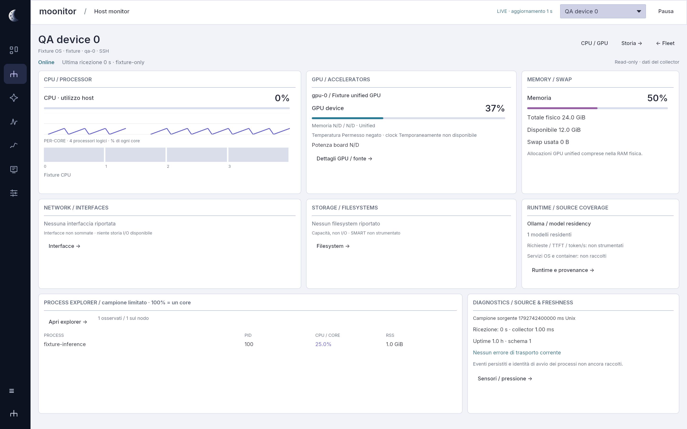
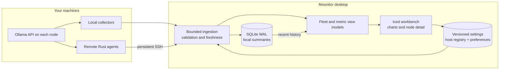

<h1 align="center">
  
  Moonitor
</h1>

<p align="center">
  <strong>Your compute lab, in focus.</strong><br />
  <sub>Native observability · Hardware · GPUs · Local AI · LAN &amp; VPN</sub>
</p>

<p align="center">
  <a href="https://github.com/mothx9/moonitor/actions/workflows/ci.yml"></a>
  <a href="rust-toolchain.toml"></a>
  <a href="#architecture"></a>
  <a href="Cargo.toml"></a>
  <a href="#roadmap"></a>
</p>

<p align="center">
  <sub>
    <a href="#the-workbench">Workbench</a> ·
    <a href="#quick-start">Quick start</a> ·
    <a href="#connect-your-fleet">Connect your fleet</a> ·
    <a href="#architecture">Architecture</a> ·
    <a href="#roadmap">Roadmap</a> ·
    <a href="#documentation">Docs</a>
  </sub>
</p>

<p align="center">
  <picture>
    <source media="(prefers-color-scheme: dark)" srcset="docs/assets/overview-dark.png" />
    <source media="(prefers-color-scheme: light)" srcset="docs/assets/overview-light.png" />
    
  </picture>
</p>

<p align="center">
  <sub>Native V3 renderer · explicit synthetic QA fixtures · 25 October 2026 · <a href="docs/assets/overview-light.png">Light</a> / <a href="docs/assets/overview-dark.png">Dark</a></sub>
</p>

Moonitor brings local and remote machines into one desktop workbench. See which
nodes are reachable, inspect their resources, identify resident AI models and
check the provenance of available power readings. Collection stays on your
machines; history stays in a local SQLite database.

Built in **Rust**, with **Iced + wgpu** for the desktop. No browser shell, cloud
account or required monitoring server. This is an actively developed product;
the [roadmap](#roadmap) separates shipped foundations from planned capabilities.

<details>
<summary>Single-host resource monitor · native renderer, synthetic QA fixtures</summary>
<p align="center">
  <picture>
    <source media="(prefers-color-scheme: dark)" srcset="docs/assets/host-dark.png" />
    <source media="(prefers-color-scheme: light)" srcset="docs/assets/host-light.png" />
    
  </picture>
</p>
</details>

## The workbench

| View | What you can inspect today |
| :--- | :--- |
| **Fleet** | Dense comparative host matrix: CPU, RAM, GPU maximum, selected interface RX/TX, state and freshness; filters, sorting, preview and bounded row virtualization. |
| **Hosts / Host monitor** | A single-node cockpit with CPU/cores, individual GPUs, physical memory/swap, interfaces, filesystems, bounded processes and diagnostics. |
| **Metrics** | Resource families with drilldown to available readings and their provenance. |
| **Processes** | Searchable CPU/RSS table; CPU is percent of one core and can exceed 100%. This remains a bounded sample. |
| **Investigate** | Five-minute CPU/RAM/GPU charts with scale, sample inspection and explicit gaps. |
| **Events** | Current source diagnostics; a persisted event timeline is not yet available. |
| **Setup** | Add/edit/remove local, SSH and inventory-only hosts, persistent theme/density/inspector preferences. |

**Moonlight** and **Deep Space** use lunar whites, midnight blues and periwinkle.
Choose them in **Setup → Appearance**; preferences survive restart. The V3 home
is a resource matrix. The previous 3D renderer remains in regression tests.

**Keyboard:** `Cmd/Ctrl + 1…7` changes section, `Alt + ←/→` changes node, and
`Tab` / `Shift + Tab` moves focus. Full assistive-technology support remains open.

### Measurements you can interpret

| Source | Available observations |
| :--- | :--- |
| **macOS / Linux** | CPU and per-core use, memory, swap, top processes, disk capacity and network-interface traffic. Linux PSI; supported temperature and battery sensors. |
| **NVIDIA · NVML** | Per-GPU utilization, memory, temperature, clocks, board power and throttle reasons, subject to device/driver support. |
| **Apple Silicon · IOKit** | GPU activity and shared-memory counters where exposed by the platform. Unified memory remains part of system RAM. |
| **Ollama · local API** | Loaded models and metadata returned by `/api/ps`. Loaded does not mean actively generating. |
| **Inventory only** | Devices without an agent remain visible as uninstrumented, without being counted as offline monitored nodes. |

Missing, unsupported, denied and stale readings are explicit states; **zero is a
valid measurement**. GPU board watts are not whole-device watts. Summary GPU
utilization is labeled as the observed maximum; individual accelerators remain
visible in node detail.

> **Current scope:** request-level token throughput, TTFT and queues are not yet
> instrumented. Events has no persisted timeline; Explore does not yet browse
> long-range history. Whole-device energy and integrated Wh are planned.
> Collection stops when the desktop closes.

## Quick start

### Build from source

Install Rust through `rustup` and your platform's native build tools: Xcode Command
Line Tools on macOS, or a C toolchain on Linux. A graphical desktop and a working
wgpu backend are required. Rust **1.96.0** is pinned in `rust-toolchain.toml`;
dependencies are pinned in `Cargo.lock`.

```sh
git clone git@github.com:mothx9/moonitor.git
cd moonitor
cargo run --release --locked -p moonitor-desktop
```

The repository is private; cloning requires access. Without an explicit or
previously installed configuration, the app enrolls the local computer with a
generated stable ID and displays real metrics. No configuration file is required.

### macOS app bundle

```sh
scripts/run.sh
```

This builds and opens `.local/moonitor.app` with the Moonitor icon. The bundle is
signed ad hoc for local use; a notarized download is not available yet.

The app creates a versioned `settings.sqlite` registry on first run. A previous
`fleet.toml` in the profile is imported once, preserving node IDs, the original file
and the separate history database. Packaging never embeds or copies a developer's
private fleet into a new installation.

| Platform | Default configuration and history directory |
| :--- | :--- |
| macOS | `~/Library/Application Support/moonitor/` |
| Linux | `$XDG_DATA_HOME/moonitor/`, or `~/.local/share/moonitor/` |

Use `--config PATH` and `--data-dir PATH` to select explicit locations.

## Connect your fleet

Open **Setup → Hosts & Connections → Add host**. Choose this computer, SSH,
or inventory-only. Enter a display name, destination alias/FQDN/IP, optional SSH
user/port and the path of an already installed compatible agent. Save applies the
configuration; IDs remain stable when labels change. Removal keeps history.

SSH uses the system client's keys and `known_hosts`, strict host-key checks and
batch mode. Moonitor does not accept unknown keys or install agents automatically.
Use your trusted administration workflow to build/install a compatible agent for
the destination's OS/architecture. An optional explicit installer is available:

```sh
cargo build --release --locked -p moonitor-agent
scripts/install-agent.sh compute.example /path/to/target-compatible/moonitor-agent
```

The [legacy configuration example](config/fleet.example.toml) is optional import
material. `--config PATH` supplies the initial import only when the registry does
not exist. `--data-dir PATH` selects an isolated profile. One local collector is
allowed. Inventories are bounded by a 1 MiB serialized settings budget; this first
engine supports **32 simultaneous collection streams**, independently of inventory
size. Additional nodes show an explicit capacity state. Fleet rendering is tested
with 500 fixture hosts; that does not qualify 500 concurrent SSH streams.

## Architecture



| Crate | Responsibility |
| :--- | :--- |
| [`moonitor-core`](crates/moonitor-core) | Shared telemetry types, availability, source/quality metadata and snapshot validation. |
| [`moonitor-agent`](crates/moonitor-agent) | Read-only platform, GPU and runtime collection at different polling intervals. |
| [`moonitor-store`](crates/moonitor-store) | SQLite WAL, five-second summaries and seven-day retention. |
| [`moonitor-desktop`](crates/moonitor-desktop) | Versioned settings, collection lifecycle, SSH, ingestion, view models and native resource workspaces. |

The diagram describes the current implementation. An optional always-on hub and
a normalized observation/event store belong to later milestones.

### Local data, explicit boundaries

- No prompt text, generated output, environment variables or full process command
  lines are collected by default.
- SSH uses strict host-key checks and batch mode; ingestion uses bounded channels
  and limits the size of incoming samples.
- Host addresses, credentials, local configuration and telemetry databases stay
  outside version control. `.local/` is ignored.
- History currently stores compact summaries, including maximum GPU utilization;
  it does not yet preserve every per-GPU series or runtime event.

## Roadmap

| Milestone | Scope | Status |
| :--- | :--- | :--- |
| **V3 W1 · First vertical slice** | Fleet-first native shell, host cockpit, settings persistence and GUI host CRUD; legacy import. | Implemented; qualification and remaining gates documented. |
| **V2 W2 · Controller / Agent** | Headless lifecycle, authenticated protocol, services, remote management. | Planned. |
| **V2 W3 · Discovery** | LAN, VPN peer providers and explicit enrollment/trust. | Planned. |
| **V2 W4 · Telemetry / Investigate** | Component history, events, services, request-level AI and energy coverage. | Planned. |
| **V2 W5 · Release** | Privacy/history audit, author-selected license, signing, packaging, accessibility and soak. | Planned. |

The supplied [V3 UI specification](docs/moonitor-v2/reference/Moonitor-V3-UI-Architecture.md)
replaces the former W1 layout. Read the [product contract](docs/moonitor-v2/product-requirements.md),
[UX system](docs/moonitor-v2/ux-design-system.md) and [qualification](docs/moonitor-v2/qualification.md).
The earlier blueprint and W0/W1 reports are historical evidence, not approval of
this design. The repository remains private; current-file cleanup does not scrub
Git history or authorize public release.

## Development

```sh
scripts/check.sh       # format, compile, clippy and workspace tests
scripts/qa-ui.sh       # graphical backend required; renderer-specific visual checks
```

CI runs Rust checks on macOS and Linux. Visual qualification is a separate local
procedure: ten views, three viewport sizes and both themes, with interaction and
metric regression checks. The first run records candidate baselines in `.local/`;
it does not count as human approval. Test fixtures are compiled only for tests.

Capture a real session with the app's screenshot command:

```sh
cargo run --release --locked -p moonitor-desktop -- \
  --theme dark --size 1440x900 \
  --screenshot .local/overview.png --exit-after 12
```

Use `--no-scene` for the list alternative. Contributors and coding agents should
read [repository instructions](AGENTS.md) before making changes.

## Documentation

| Start here | Engineering and evidence |
| :--- | :--- |
| [Product blueprint](docs/moonitor-professional-upgrade-blueprint.md) | [Architecture](docs/architecture.md) |
| [Requirements](docs/requirements.md) | [W0 audit, decisions and plan](docs/moonitor-w0-audit-and-plan.md) |
| [W1 interface design](docs/moonitor-w1-interface-design.md) | [W0 qualification](docs/moonitor-w0-qualification.md) |
| [Brand assets](assets/brand/README.md) | [W1 qualification](docs/moonitor-w1-qualification.md) |

---

<p align="center"><sub>Every number has a source. Every state has a meaning.</sub></p>
