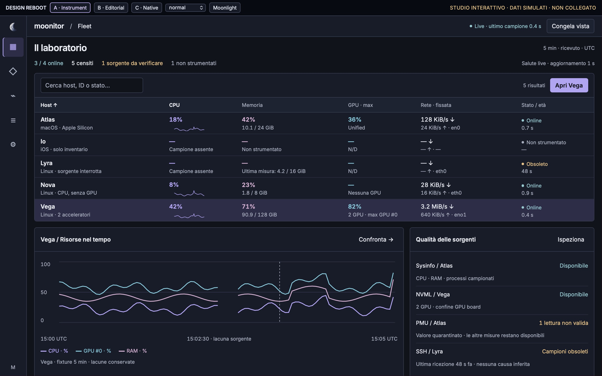
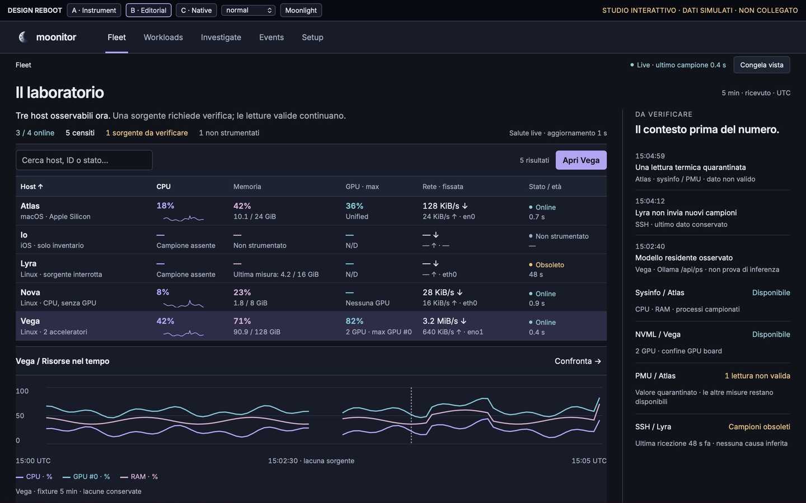
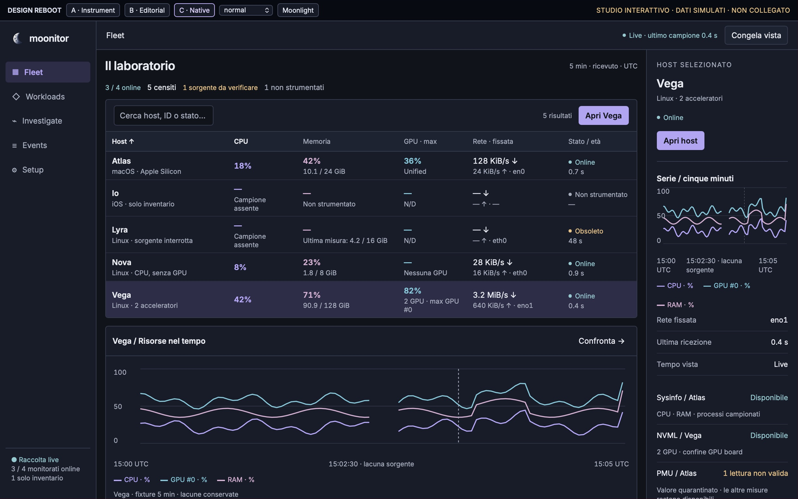
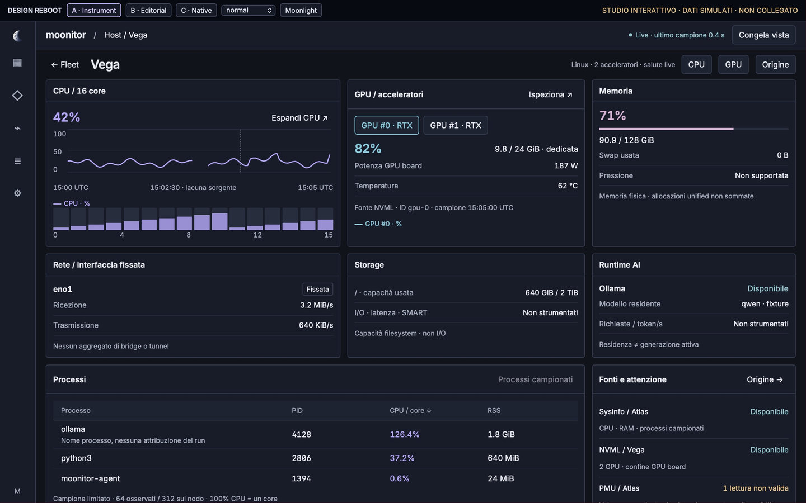
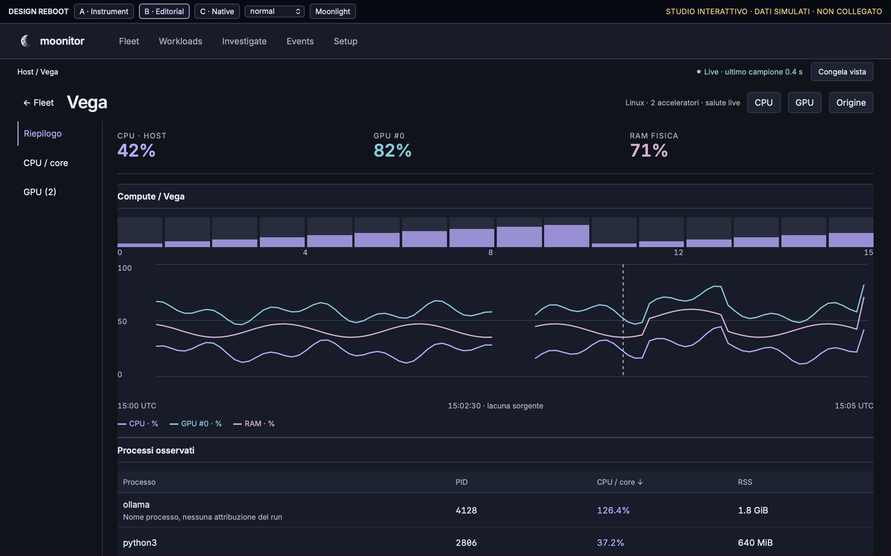
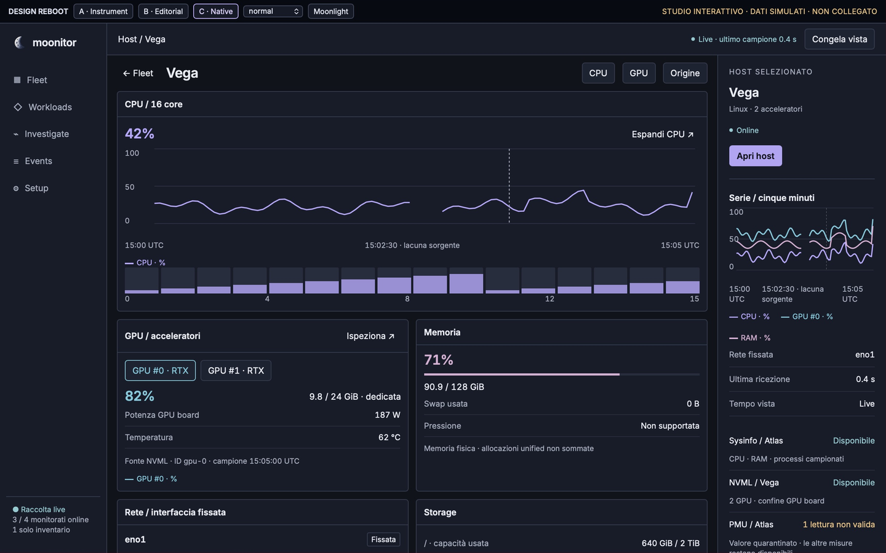
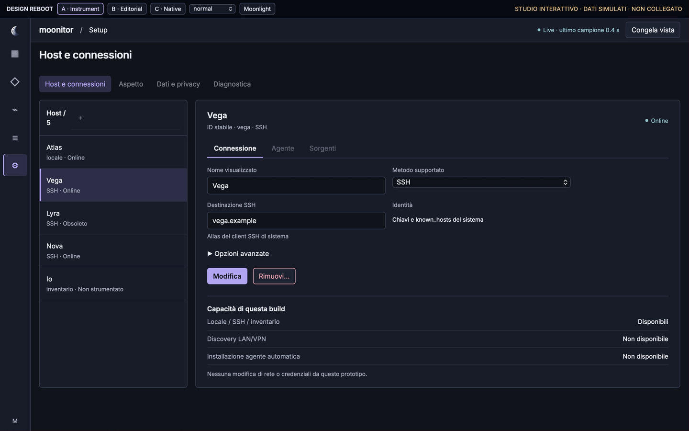
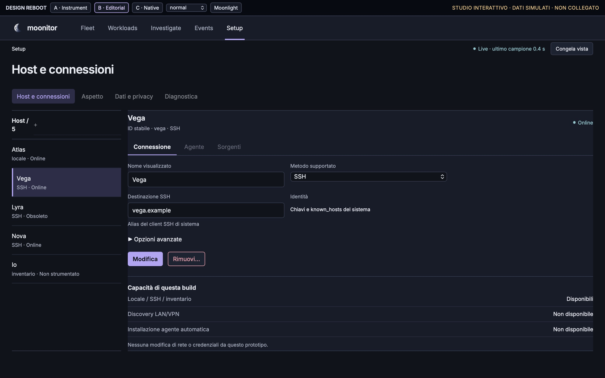
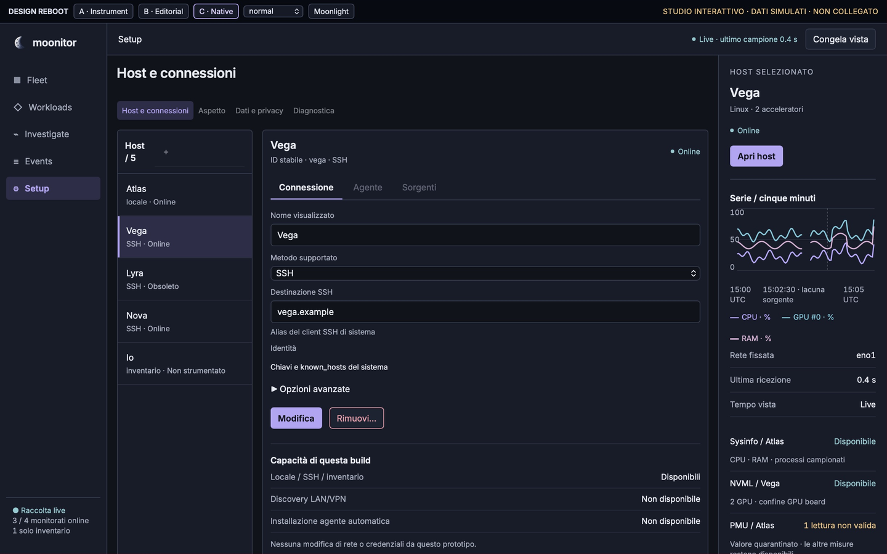

# Moonitor · Design Reboot

**Current checkpoint: S0 trust corrections + S1 design study. No composition has
been selected or approved. The working native app remains available.**

The supplied [mandate](CODEX_MANDATE_UX_REBOOT.md) and
[RFC](MOONITOR_DESIGN_REBOOT_RFC.md) supersede incompatible V3 layout decisions.
They were imported verbatim from the owner's package. The original
[acceptance matrix](UX_ACCEPTANCE_MATRIX.md) is preserved; actual results and open
gates are tracked in [verification status](VERIFICATION-STATUS.md).

- [Audit delta and phased implementation](AUDIT-AND-PLAN.md)
- [S0 corrections and qualification](S0-qualification.md)
- [Canonical state, tokens, components and native boundaries](STATE-AND-COMPONENT-CONTRACT.md)
- [Operator tasks / behavioral research](BEHAVIORAL-RESEARCH.md)
- [Frontend accessibility ADR](ADR-frontend-accessibility.md)

## Three composition candidates

All values and generic host names below are **explicit design fixtures**. This
studio has no production-profile, collector or telemetry connection. It is plain
local HTML/CSS/JS with project assets, not a proposed browser-based application.

| Direction | Spatial decision and purpose | Cost / review concern |
|---|---|---|
| **A · Instrument** | Compact rail, six-column fleet matrix, resource timeline + source column; host panels in a stable grid. Fast scanning and parallel CPU/GPU/RAM inspection. | Icon rail needs discoverable labels; panel count and host scroll still require optical review. |
| **B · Editorial** | Horizontal navigation, wide evidence column with narrow issue feed; host has a resource index and one broad chart. Prioritizes reading a diagnosis and inspecting context. | Less simultaneous resource coverage; at 1280 the chart legend may require workspace scroll. |
| **C · Native** | Labeled source sidebar, central workspace and persistent selection/source inspector. Predictable object selection and preview. | Inspector consumes grid width; narrow viewport should allow collapse in native implementation. Secondary host panels scroll. |

### Fleet · same 1440×900 fixture

| A · Instrument | B · Editorial | C · Native |
|---|---|---|
| [](previews/A-fleet-1440-dark.png) | [](previews/B-fleet-1440-dark.png) | [](previews/C-fleet-1440-dark.png) |

### Host · same 1440×900 fixture

| A | B | C |
|---|---|---|
| [](previews/A-host-1440-dark.png) | [](previews/B-host-1440-dark.png) | [](previews/C-host-1440-dark.png) |

### Setup · same 1440×900 fixture

| A | B | C |
|---|---|---|
| [](previews/A-setup-1440-dark.png) | [](previews/B-setup-1440-dark.png) | [](previews/C-setup-1440-dark.png) |

[Full preview catalog](PREVIEW-CATALOG.md): Fleet/Host/Setup at **1280×800 and
1440×900, both themes**, plus edge-state compositions. PNG crops exclude browser
chrome and preserve a visible simulation banner. The capture manifest documents
CSS viewport, screenshot scale and source hashes. Browser typography is not native
Iced optical evidence.

## Run the interactive study

From repository root:

```sh
python3 -m http.server 8766 --bind 127.0.0.1
```

Open `http://127.0.0.1:8766/design/reboot/`. A/B/C and theme controls are in the
studio bar. `viewport.html?w=1280&h=800&direction=A&view=fleet&theme=dark`
provides a fixed CSS viewport for review. Available `view`: fleet, host, setup;
additional Investigate/Workloads/Events surfaces only illustrate shared context.

Try: filter → select row → open name / Enter → CPU or GPU → GPU #1 → Origine →
close → Fleet. Freeze leaves the independent health text live. Setup → Modifica
→ invalid destination → Applica alla fixture preserves draft; Remove opens a real
HTML dialog, Esc cancels. New-host flow, process filtering, chart brushing and
non-host Setup tabs are outside this study and are not claimed implemented.
Chart hover currently illustrates a fixed sample; it is **not a functional
crosshair inspector**. Production chart interaction is a separate acceptance gate.

The scenario selector covers hidden selection, frozen time, invalid source,
inventory-only host, empty profile, multiple GPUs and save error. `node=nova`
with `view=host` demonstrates capability-aware CPU-only composition. These fixtures
never alter the working app. Reload resets edits/removals in the study.

## Review and next boundary

Compare the same three tasks and both sizes before choosing: find an issue, inspect
one GPU/source, edit/cancel host configuration. Record preference plus rejected
parts in this folder; automated screenshots do not constitute owner approval.
After composition review and an explicit frontend decision, S2 builds common native
components; S3 wires one complete live diagnostic path and removes its legacy
fallbacks. No sweeping frontend rewrite was started before that gate.
