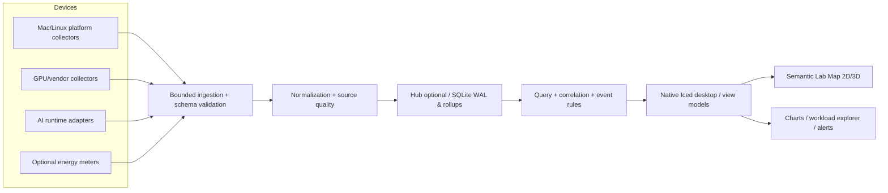

# Moonitor · Professional Upgrade Blueprint

Data review: 23 ottobre 2026  
Target: Moonitor 2.0, desktop-native local-first observability for personal compute and AI labs  
Repository: mothx9/moonitor (privato)  
Branch remoto analizzato: main, commit ba91ef433e83721ea52aad6fbea0d32a30bccf84 (22 ottobre 2026)  
Materiali UI: screenshot e registrazione forniti dall'utente, relativi alla build locale Iced/3D non pubblicata nel branch esaminato.  
Tipo di lavoro: review e target design, nessuna modifica al repository.

## 0. Decisione di prodotto

Moonitor non sarà soltanto un aggregatore di metriche CPU/RAM/GPU per cinque computer. Diventerà un observability workbench locale capace di rispondere a quattro domande:

1. Che cosa sta succedendo nella flotta, adesso?
2. Quale workload/modello/processo causa un cambiamento e come si spiega?
3. Quali prestazioni e consumi sono misurabili, con quale confidenza?
4. Quale azione conviene valutare, senza sacrificare sicurezza e controllo dell'utente?

North-star: Understand, compare and diagnose the behavior of your personal compute lab, especially local AI workloads, without a cloud requirement.

Differenziazione: correlazione fra hardware eterogeneo, inferenza locale, energia e timeline degli eventi. Non competere sul mero inventario host con Netdata, Beszel o Grafana. Non trasformarlo prematuramente in un orchestratore di workload né in un agente che esegue comandi sui nodi.

## 1. Ambito e limiti della verifica

Nel repository main sono presenti quattro crate (moonitor-core, moonitor-agent, moonitor-store, moonitor-desktop). Il desktop pubblicato è egui/eframe + glow/OpenGL. La UI Iced + wgpu + 3D visibile nella registrazione risulta solo locale; non è possibile revisionarne la sorgente scene.rs o gli shader dal repository remoto. Le note tecniche locali fornite dall'utente indicano che tale versione disegna cinque oggetti indipendentemente dalla flotta configurata e non riflette lo stato online/offline nello shader: considerare questi problemi da verificare nel codice locale, non problemi confermati nel branch GitHub.

### Elementi riutilizzabili

- moonitor-agent: raccolta local/SSH di CPU, RAM, processi, filesystem, reti, Linux PSI, NVIDIA NVML e Apple IOKit; polling a frequenze differenti.
- moonitor-core: tipi con distinzione esplicita fra Reading::Available e Reading::Unavailable; indicazione della sorgente e qualità.
- moonitor-desktop/engine.rs: SSH persistente con known-hosts e batch mode, payload di dimensione limitata, canali bounded e reconnect.
- moonitor-store: SQLite WAL, campionamento di riepiloghi, retention e test null-vs-zero.
- config: validazione di ID, alias SSH e percorsi agent.
- Script e note di qualification già presenti.

### Debiti verificati

| Tema | Prova nel codice pubblicato | Implicazione |
| --- | --- | --- |
| Store nel processo desktop | Engine::start apre history.sqlite; README precisa che il desktop deve restare attivo | Lo storico si interrompe quando l'app viene chiusa |
| Modello AI centrato su Ollama | HostSnapshot.ollama: RuntimeSnapshot; collect_ollama() legge /api/ps | Non esiste un'ontologia generale di runtime e inferenze |
| Storico povero | samples(node, received_ms, source_ms, cpu, memory_percent, gpu, gpu_board_watts) | Non conserva GPU individuali, runtime, eventi, sorgenti e granularità utile all'analisi |
| GPU sintetizzate col massimo | store e engine calcolano max() delle utilization dei GPU | Perdita della differenza fra acceleratori multipli |
| Processi parziali | Top 64 CPU + 32 candidati AI per nome, non un censimento esaustivo | UI non deve promettere un process manager completo |
| Test limitati | Sette test riportati in qualification; CI Rust static/unit | Nessuna verifica adeguata della nuova UI, screenshot o interazioni |
| Distribuzione locale | .app costruita da script, firmata ad-hoc, con .local/fleet.toml incluso nel bundle | Non è una release distribuita/notarizzata; configurazione locale da separare dal bundle |
| Qualità delle letture | Reading<T> è un buon inizio; validazione HostSnapshot ancora parziale | Estendere controlli di range, clock, fonti, stale e copertura |

## 2. Audit dell'interfaccia Iced/3D (screenshot e video)

### Criticità P0/P1

P0 · Metri coerenti e visibili: le percentuali devono sempre essere leggibili, non soltanto la progress bar; ogni numero deve avere etichetta, unità, definizione, fonte, stato, timestamp. Fallimento di visualizzazione = bug funzionale.

P0 · Data-driven scene: la scena contiene esattamente i nodi del modello di flotta e li aggiorna con aggiunta/rimozione, scelta dispositivo, online, stale, unreachable, uninstrumented. Nessun oggetto hard-coded. Un nodo non monitorabile non entra nel denominatore “nodi online”.

P1 · Information architecture: la sidebar ripete dispositivi che appaiono nuovamente in scena e card; la navigazione privilegia categorie di risorse (processi, dischi, rete) più che casi d'uso (flotta, workload, energia, problemi).

P1 · Home data-first: la grande scena isometrica domina la vista; gli andamento e le attività importanti finiscono sotto il fold. Nessuna diagnosi sintetica o spiegazione di cambiamenti.

P1 · Pagine vuote: selezionare iPhone in AI locale produce una pagina quasi tutta vuota con “Telemetria non disponibile”; l'assenza del sensore va trattata in un componente riutilizzabile che spiega perché e cosa è possibile configurare, non con chilometri di superficie vuota.

P1 · Charts deboli: linee sottilissime in assenza di tempo/scala leggibili, nessuno zoom/brush/crosshair, nessuna sovrapposizione di eventi, nessuna comparazione multi-nodo; il range è sempre 5 minuti.

P1 · 3D come illustrazione: oggetti procedurali generici, scala e illuminazione da mockup, nessuna topologia autentica, connessione o flusso rappresentato. Rendering senza semantica.

### Conservare dalla direzione visiva

Nome Moonitor, simbolo lunare, palette verde/salvia, pulizia e ampio spazio di lavoro, sensazione di desktop tool e non di sito web. Il problema non è il minimalismo: è l'insufficiente priorità alle informazioni e l'assenza di un sistema visuale/di interazione rigoroso.

## 3. Information architecture v2

### Navigazione primaria

| Sezione | Domanda / azione principale | Contenuto minimo |
| --- | --- | --- |
| Overview | La flotta sta bene? Che cosa richiede attenzione? | Stato reale, carichi AI, GPU, energia misurata, anomalie, eventi recenti |
| Fleet | Quali nodi ci sono e come si relazionano? | Inventario, stato, capacità, connettività, gruppi, topologia; drilldown |
| Workloads | Che cosa sta girando, dove, con quali prestazioni? | Runtime, modelli, esecuzioni, code, token/s, TTFT, tempi, risorse |
| Energy | Quale potenza misurabile, quanta energia, quale efficienza? | Scopes, fonti, W/Wh, copertura, confronti con finestre equivalenti |
| Events | Che cosa è cambiato? Quando e perché? | Timeline unificata di eventi, alert, disconnessioni, inizi/fini job |
| Explore | Confronta dettagli storici e correlazioni | Filtri per metrica/nodo/run, timeframe, overlay e annotazioni |
| Settings | Come sono collegate fonti e dati? | Onboarding, agenti, connessioni, sensori, storage, accessibilità, privacy |

Processi, storage, rete, sensori e GPU specifiche vivono dentro il dettaglio del nodo, non come sei sezioni globali equivalenti. Si può aggiungere un'area Diagnostics mirata dopo il primo release candidate.

### Pagina Overview, viewport desktop di riferimento

Top bar: logo compatto, Overview, breadcrumb di contesto, selettore finestra temporale, freshness, comando ricerca globale e stato della raccolta.

Riga 1: quattro KPI interpretabili: (1) nodi monitorati vs censiti, (2) workload AI attivi e in attesa, (3) GPU occupate/capacità, (4) potenza totale solo se interamente e non ambiguamente misurata. Se non misurabile, mostra “copertura energetica” o “potenza GPU misurata”, non inventare watt totali.

Riga 2, 65/35: a sinistra vista timeline delle risorse/workload con selettore CPU/GPU/RAM; a destra “Lab Map” compatta in 2D/3D con device state e collegamenti realmente conosciuti. La Lab Map può diventare full-screen in modalità immersiva.

Riga 3: tabella Workloads attivi, con nodo, modello, runtime, tokens/s, TTFT, CPU/GPU attribuibili, ultime attività; empty-state valido se i runtime non espongono dati.

Riga 4: Events/Alerts sintetici e stato/qualità delle sorgenti. I grafici non devono apparire soltanto dopo uno scroll profondo.

### Dettaglio dispositivo

Header persistente: nome, alias, chipset, OS, stato + ultimo contatto + sorgente. Tab interni: Summary / Compute / Processes / Storage / Network / AI / Sensors / History. Non duplicare le card dispositivo in ogni pagina: usare un device switcher unico, accessibile da top bar, command palette e Fleet.

## 4. Design system (proposta da approvare con mock e screenshot)

Identità: instrument-grade, quiet premium, editorial clarity. Non glassmorphism gratuito, non dashboard piena di chip e ombre, non cartone 3D.

- Palette: canvas chiaro caldo #F6F8F5, surface #FFFFFF, testo primario #17251F, testo secondario #65756C, bordi #DDE5DD; dark canvas #0D1613, surface #14201A, testo #EAF2EC. Accento salvia/verde solo per enfasi e selezione; rischio non usa lo stesso colore del brand.
- Tipografia: SF Pro/System oppure Inter per UI; mono tabulare (SF Mono/Geist Mono) per timestamp, valori e identificatori. Headline 28–32, page headings 19–22, testo 13–14, metadati 11–12, KPI 24–30.
- Layout: scala 4/8pt, card con padding 16–24, raggio coerente 12–14, bordi fini; sidebar 208–224 px collassabile; barra superiore 56–64; ritmo verticale ripetibile; densità default e compact.
- Color semantics: Healthy, Busy, Warn, Critical, Stale, Uninstrumented, Unreachable, Unknown. Mai affidare lo stato esclusivamente al colore.
- Data vis: gridline discrete, assi e tooltip precisi, unità esplicite, marker per assenza/stale e per eventi. No linee continue attraverso missing-data. Time range comuni: live, 15m, 1h, 24h, 7d (solo se storage supporta).
- Motion: 3D e micro-animazioni on-demand, reduce-motion supportato. Focus/keyboard/contrast prima di spettacolo.
- Locale: italiano/inglese attraverso message catalog, unità coerenti SI/IEC (MiB vs MB) e formati locali.

### 3D: decisione architetturale

Non rimuovere la scena, ma cambiare il suo ruolo. Lab Map è un componente di osservabilità, non un'immagine di copertina. Ogni asset (glTF ottimizzato o geometria parametrica curata) ha device ID, stato, label, health ring e popover. La scena deve ridimensionarsi 0–32 nodi, degradare bene senza GPU supportata, e consentire list-view alternativa. Implementare il rendering solo quando l'utente interagisce o lo stato visibile cambia; idle non deve causare animazione continua. Per grandi flotte raggruppare i device, evitare la pretesa di modelli hardware fotorealistici per ogni variante.

Scelta UI tech: mantenere Iced + wgpu provvisoriamente. Non cambiare framework per gusto estetico prima di misurare input latency, resa tipografica, accessibilità, native behavior, screenshot deterministici e rendering su macOS/Arch. Effettuare un ADR solo se emerge un limite riproducibile.

## 5. Data model 2.0

Il crate moonitor-core deve distinguere entity, observation, measurement, event, runtime, workload, source:

- Node: identità, piattaforma, capability discovery, connettività, ultima ricezione.
- DeviceComponent: CPU package/core, GPU accelerator, SoC, disk, network interface, energy meter, memory domain.
- MetricDescriptor: key canonica, unità, aggregabilità, scope, qualità, tipo (gauge/counter/histogram).
- Observation: node/component/workload IDs, sampled_at, received_at, value, availability reason, source, source version, quality, freshness.
- RuntimeInstance: engine (Ollama/vLLM/YVEX/MLX/altro), host, port/path opzionale, capability set, status.
- ModelInstance: model ID, quantization, context, residency, memory accounting e origin runtime.
- WorkloadRun: run ID/correlation ID, runtime, model, host, state, start/end, batches/requests/tokens latencies quando strumentate.
- Event: device connect/disconnect, runtime up/down, model loaded/unloaded, run lifecycle, metrics threshold, storage error, performance anomaly.
- EnergyObservation: boundary (GpuBoard, CpuPackage, SoC, WholeDevice), meter ID, W, intervalli validi, coverage, provenienza.

Invarianti: assente ≠ zero; stale ≠ offline; fonte nominale ≠ valore garantito; GPU unified ≠ VRAM aggiuntiva; non sommare sensor boundary sovrapposte. Timestamp della sorgente e della ricezione separati; metriche del runtime non inferite da percentuali GPU. Per il valore totale energia, esigere sorgente esplicita e copertura misurata; integrazione Wh ammessa soltanto su intervalli validi, con lacune annotate. Non attribuire energia a un run quando più workload condividono la stessa GPU senza una metodologia verificabile.

## 6. Architettura tecnica target

Deployment phase 1: agent read-only e SSH persistente come ora; desktop locale operativo e fallback offline. Phase 2: moonitor-hub opzionale headless always-on su Zima, riceve/coordina campioni dai nodi e persiste storico senza desktop aperto, con spool/replay e deduplication. I nodi più sensibili non devono necessariamente esporre un listener: preferire SSH fidato o canale outbound autenticato, scegliendo esplicitamente transport policy. Autorizzazioni di rete minimali.

Persistence: partire da SQLite e migrazioni forward-only versionate. Tabelle per entities, metric descriptors, timestamped samples (con status), events, runtime/workload runs, alert states, source diagnostics. Rollups (1s/10s/1m/5m) e retention configurabile; nessun ingresso illimitato di labels/cardinalità. La dashboard non interroga continuamente snapshots completi. Non introdurre Prometheus/ClickHouse senza un benchmark che lo giustifichi; supportare import/export OpenTelemetry e Prometheus come adapters, non come obbligo di infrastruttura.

AI observability adapters prioritari: YVEX locale (strumentazione esplicita e consensuale), Ollama (stato modello e dati per richiesta solo dalle API/integrazioni che li espongono), vLLM (Prometheus /metrics, richieste se abilitate), in seguito llama.cpp/MLX. Per ogni adapter dichiarare capability matrix: model_state, queue, tokens, TTFT, ITL, KV-cache, memory, power, request_traces. Non millantare attributi assenti.

Alerts: rule engine locale read-only, threshold+durata, dedup e quiet period, provenance, ack, event timeline; prima avvisi in-app, poi integrazioni configurabili. Nessun blocco o kill di processo da alert automatico.

## 7. Roadmap e acceptance gates

### Wave 0 — Consolidare e qualificare il lavoro locale (P0)

1. Salvare senza perdite la versione Iced/3D in un branch separato; versionare sorgenti, shader e test, non .local/ con configurazioni private. Conservare un baseline tag del vecchio desktop.
2. Riprodurre e correggere le metriche illeggibili con una single source of truth per text/bar/tooltip, fallback esplicito N/D, zero visualizzato come 0%.
3. Eliminare nodi hardcoded, rendere la scena derivata dalla config e da NodeState, usare veramente stati availability/freshness nel rendering; test con 0 (empty UX), 1, 2, 5, 16, 32 nodi (distinguendo le config non valide).
4. Test UI con screenshot di Overview/AI/History/Processi in 1280x800, 1440x900, 4K, light/dark, Mac e Linux; click/keyboard/scroll/modal/empty/stale.
5. A/B baseline dei collector con inferenza AI su Exon e Spark; screenshot e video della build verificata, non solo cargo test.

Gate W0: una persona diversa da chi sviluppa riconosce stato dei dispositivi e valori CPU/GPU senza ambiguità; visual diff e interazioni riproducibili; repo/bundle/local allineati.

### Wave 1 — Product design e nuovo shell desktop (P1)

1. Definire screen map con Overview, Fleet, Workloads, Energy, Events, Explore, Settings e device detail; wireframe prima del coding.
2. Tokens visivi, griglia, responsive states, data-viz, empty/error/loading, keyboard, reduced-motion, unit e locale.
3. Costruire UI component library isolata: MetricCard, StatusBadge, NodeSwitcher, TimeRange, MetricChart, EventsTable, UnavailableState, SourceTooltip.
4. Overview semantic data-first; Lab Map sempre sincronizzata col modello dati, non più dominante.

Gate W1: niente valori fuori viewport senza ragione; ogni view deve rispondere a un quesito operativo; accessibilità minima e screenshot approvati.

### Wave 2 — Observability core e timeline (P1)

1. Normalizzare serie/capability/source + schema evolvibile; migrazioni DB e golden fixtures.
2. Conservare i singoli componenti e serie importanti, eventi temporali e stati runtime.
3. Time ranges multipli, downsampling, zoom, inspect, comparazione per nodo e correlazione di eventi.
4. Separare ingestion, query e view models; errori e dropped samples visibili.
5. Valutare hub always-on su Zima solo dopo lo storage locale stabile.

Gate W2: recuperare sessioni storiche con desktop chiuso (quando hub attivo), grafici non collegano gap, unavailable/stale/source verificati su scenari sintetici.

### Wave 3 — AI workloads, potenza ed efficienza (P1/P2)

1. Integrare almeno un runtime realmente in esecuzione con richieste misurabili; test end-to-end: start→request→stop, GPU e timeline.
2. Metriche runtime reali: throughput, queue, TTFT/ITL, context, KV-cache, token counts, p50/p95 quando disponibili; normalizzazione di unità/definizioni.
3. Potenza GPU NVIDIA e altri sensori dichiarando lo scope; external wattmeter opzionale per whole device.
4. Energia Wh con coverage; comparatore performance/watt solo per misure comparabili.
5. Eventi correlati, alert e report di sessione esportabile con provenance.

Gate W3: rispondere per almeno un lavoro AI reale “chi, dove, quanto, da quando, cosa è cambiato?” con link ai campioni originali e dichiarazione dei limiti.

### Wave 4 — Release engineering e operatività (P1)

1. Package macOS pulito con config in Application Support, senza file .local/fleet.toml dentro release distribuite; signing/notarization/distribution per release esterne.
2. Install/update agent via SSH con protocol/schema negotiation, rollout/rollback e fail-safe.
3. CI multi-platform, snapshot/golden tests, soak ≥24h, reconnect network/sleep-wake, benchmark overhead inference on/off.
4. Backups/migrations, import/export redatti, error reporting locale, log rotation, diagnostics bundle privacy-safe.
5. Versionamento coerente binary/schema/desktop e release notes.

Gate W4: clean install e upgrade senza perdita di dati, senza disclosure di configurazioni private e senza monitor disconnesso che passa per “online”.

## 8. Casi di test non negoziabili

- Metriche 0, None, Unsupported, PermissionDenied, NotConfigured, TemporarilyUnavailable mostrate distintamente.
- Cambiamento 5→1 nodo produce 1 asset 3D, 1 card e 1 item inventario; i nodi non monitorati non contano come offline.
- Un GPU Apple Unified non aggiunge 24 GB al RAM totale del nodo; Spark NVML memory Unsupported non appare 0 GiB.
- Due GPU sullo stesso nodo rimangono due entità; il valore sintetico (max/sum) reca etichetta e significato.
- Un gap SSH interrompe la linea storica e marca stale; retry e recupero non creano duplicati o contatori negativi.
- Una visita ad AI locale con dispositivo non supportato non genera pagina bianca, ma empty state informativo e navigazione valida.
- Storico 7d, clock drift, sequenze fuori ordine, database riavviato, migrazioni e corruzione leggera hanno percorsi di recovery testati.
- Bench di inferenza senza/col collector su carico riproducibile, con almeno 5 repliche e statistica su throughput, TTFT, GPU/CPU power, collector overhead e intervalli di confidenza.
- Nessuna raccolta di prompt, output, variabili d'ambiente, token segreti o command line integrali per default.

## 9. Metriche di accettazione (budget preliminari, da confermare con misure)

- Idle desktop+collector: obiettivo indicativo <2% di un core logico e <150 MiB RSS endpoint sul Mac target; qualificare separatamente con scena visibile/nascosta e background/foreground. Non presentare come già garantito.
- Rendering in quiet state: nessuna animazione continua e refresh di scena solo su dati/interazione; GPU overhead ridotto al minimo durante inferenza.
- Telemetry latency: p95 da ricezione campione a UI aggiornata <1 s, con stato freshness evidente, nelle condizioni hardware previste.
- Inference impact: obiettivo <2% regressione mediana throughput in confronto paired on/off e nessuna regressione sostanziale di TTFT p95; misurare anziché promettere.
- Reliability: no data loss silenziosa; backlog e drop conteggiati e visibili.
- UI: no clipping/overlap per viewport di test, tastiera, reduced-motion, contrasti, nessuna selezione desincronizzata, eventuali stati stale distinguibili.

## 10. Ordine di lavoro per Codex

Prima PR consigliata, strettamente limitata: W0 - checkpoint Iced UI + correctness + deterministic QA.

- Commit il lavoro Iced/3D su branch feature/native-workbench senza .local/segreti; allineare dipendenze/doc.
- Estrarre FleetViewModel e DeviceSceneModel derivati dall'unico stato ingestito; rimuovere ogni array hard-coded.
- Test automatici su flotta variabile e availability state.
- Rendere metric label/value/bar/tooltips un'unica componente tipizzata con unavailable supportato.
- Snapshot/interaction tests per schermate e dimensioni, con artifacts registrati in .local/qa ignorata.
- Benchmark A/B su Mac con scena idle e caricata; Exon/Spark con carico AI rappresentativo.
- Niente nuove sezioni decorative o librerie prima che i gate P0 siano superati.

Seconda PR: W1 - design system / information architecture scaffold con fixture canoniche e schermate Overview, Fleet e Workloads; 3D ridotta e semanticamente utile.

Terza PR: W2 - normalized timeseries + event model con migrazione SQLite e view models per query.

Non creare 20 schermate e non introdurre un hub distribuito prima che il primo taglio verticale (una workload AI osservabile su un nodo, una timeline e un insight verificabile) funzioni davvero.

## 11. Risorse di riferimento

Fonti repo: README, architecture, requirements, qualification, core, agent, engine, store, packaging.

Standards/ecosistema: Beszel, NVIDIA DCGM exporter, vLLM metrics, OpenTelemetry GenAI semantics, Netdata anomaly detection.

## Regola del progetto

Ogni schermo deve rispondere a una domanda; ogni numero deve spiegare la propria origine; ogni animazione deve rappresentare qualcosa; ogni nuova feature deve passare test con dati reali o fixture esplicite.
