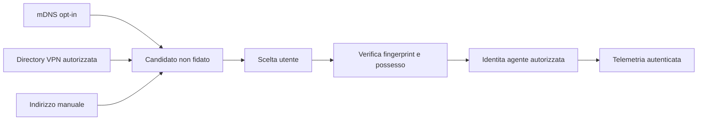

# Discovery e sicurezza — target, non feature W1

Discovery produce candidati; non autentica. LAN mDNS è link-local, un client VPN
fornisce al più peer/route. WireGuard non è discovery di servizi. Nessun nuovo
listener, scan o lettura credenziali VPN viene introdotto dal percorso W1.

Oggi: SSH read-only con BatchMode, StrictHostKeyChecking=yes, timeout, keepalive,
payload limitato e path/argomenti validati. Password/token non in DB. GUI può
configurare una destinazione e osservare l'esito; non accetta automaticamente
una host key, non installa software e non esegue comandi arbitrari.

W2: ADR mTLS, identità stabili distinte da hostname/IP, revoca, rotazione e replay.
W3: provider con budget di concorrenza, TTL, opt-in e nessuna enumerazione globale.
Endpoint LAN/VPN dello stesso agente deduplicati solo dopo verifica identità.

Pubblicazione: ripulire file correnti non cancella la storia. Repository privato
e storia immutata fino a piano separato, backup e autorizzazione del proprietario.
Licenza, firma/notarizzazione e cambio visibilità non sono autorizzati implicitamente.
