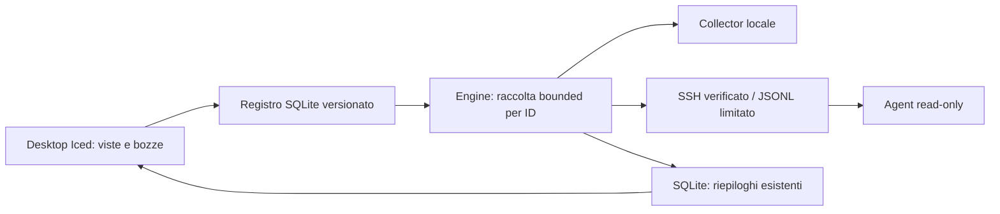

# ADR 002 — conservare SSH, preparare il Controller

Stato: decisione W1; protocollo remoto futuro ancora da qualificare.

Il confine pratico W1 è tra configurazione effettiva, engine e view model. Niente
dipendenze grafiche nell'agent. Eventi riferiti a ID stabili, non posizione nel
vettore; cambi di configurazione non devono riassegnare campioni a un altro host.
Code, frame e finestre storiche restano bounded. Nessun daemon installato.

Target W2: Controller senza UI, IPC autenticata locale, agent service e protocollo
versionato. gRPC/Protobuf+mTLS è una proposta della RFC, non una dipendenza aggiunta
oggi. ADR definitivo dopo spike di compatibilità, heartbeat/reconnect, limiti,
revoca e test delle identità. Nessuna garanzia di raccolta a desktop chiuso in W1.

Lo storico corrente resta append-only con retention. Nuove serie, component ID,
eventi e migrazioni appartengono a un cambiamento distinto, con fixture golden.
