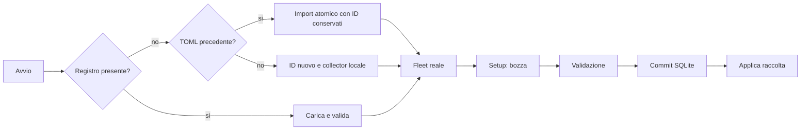

# Setup e migrazione

Il percorso W1 abilita questo computer senza wizard obbligatorio. L'utente può
aggiungere altri host da Setup. Nessun input TOML necessario per un profilo nuovo.

Registro tipizzato in `settings.sqlite`, schema versionato e transazioni atomiche.
Configurazione valida prima del commit; conflitti fra due finestre non sovrascrivono
silenziosamente aggiornamenti. Preferenze e host condividono una revisione.

Import automatico una sola volta dal percorso configurato o Application Support;
file originale intatto. Database storico separato: modifica alias non cambia ID;
rimozione non cancella campioni. Nessun rollback automatico a config vuota se DB
corrotto: errore esplicito e recupero dal backup, senza sovrascrivere.

Host: nome, trasporto Local/SSH/Inventory, destinazione SSH (alias/FQDN/IP), utente,
porta, path agente; chiavi/password non salvate. ID assegnato alla creazione e
immutabile in modifica. Un solo collector locale. Campi inutili per il trasporto
vengono normalizzati. SSH richiede agente già installato e trust di sistema.

Tema, densità, inspector e rail sono persistenti; `--theme` è un override di avvio.
Setup mostra quali impostazioni hanno effetto immediato e gli errori del salvataggio.
Discovery, installazione remota, secret store e controller richiedono W2/W3.
